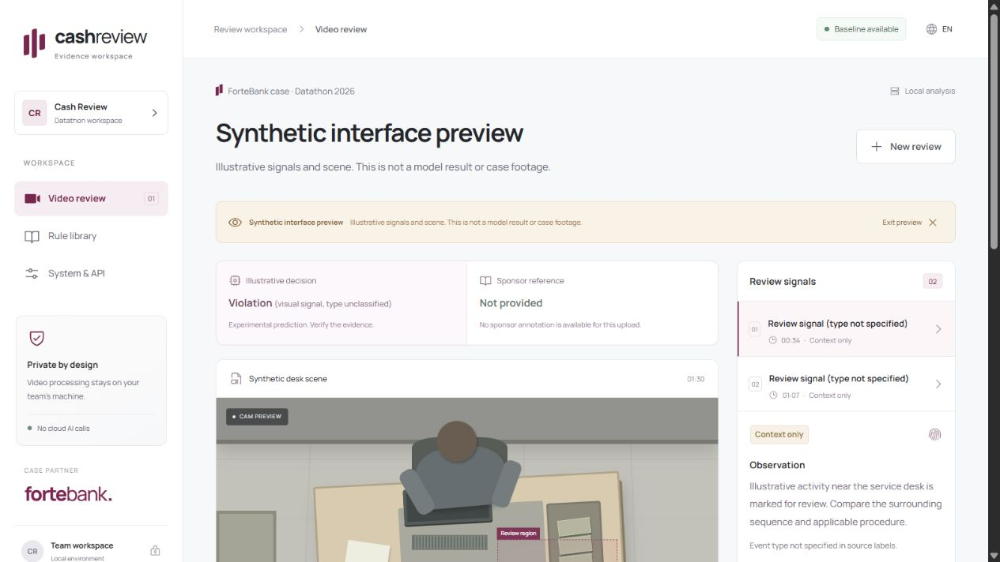

# Cash Review

A local video analysis and evidence-review workspace for the ForteBank Datathon. Built for the [Review. repository](https://github.com/karimbeksultan/Review.).

Upload a MOV, follow a real asynchronous job, inspect timestamped JPEG evidence, and review the regulatory context. The React interface has English and Russian copy, a synthetic preview, a rule library and a system/API view. The FastAPI service uses private files, a durable SQLite queue and a CPU-only local model. No video, frame or description is sent to cloud AI.

**Current scope:** an experimental visual-pattern baseline, not a validated semantic violation detector. Binary labels do not identify action categories. The API preserves the case's `violation` / `no_violation` contract, but those outputs require human review. Legal claims are disabled in the rule registry. A polished interface does not establish competition readiness; see [release evidence](docs/jury_evidence.md).

**Measured limitation:** the first frozen holdout contained eight unique clips. The baseline flagged all eight, including four normal clips: 50% accuracy and 0% specificity. A second classifier failed validation and was rejected before test evaluation. This is a working review application with an inadequate detector baseline; it needs better action annotations and model validation before competition claims.



## Run locally

Requirements: Python 3.12, Node.js 22, approximately 2 GB free disk for dependencies/data, and permitted local access to the supplied dataset. No GPU is required. Download dependencies and the backbone while online; processing then runs locally. Do not upload the case data to public services.

```powershell
python -m venv .venv
.venv/Scripts/python -m pip install -r backend/requirements.lock.txt
cd frontend
npm ci --no-audit --no-fund
npm run build
cd ..
```

Prepare the frozen Apache-2.0 MobileNetV2 representation and train a local classifier. `open/` must contain `open_labels.xlsx` and `videos/*.mov`. Keep that folder outside this repository. Training preserves exact Unicode filenames, groups identical content together and freezes a class-stratified split before fitting or tuning.

```powershell
.venv/Scripts/python backend/scripts/prepare_model.py --model-dir models
.venv/Scripts/python backend/scripts/train_baseline.py --data-dir 'C:/private/open' --model-dir models
.venv/Scripts/python backend/scripts/evaluate.py --model-dir models --runtime-smoke
.venv/Scripts/python backend/scripts/prepare_reference_labels.py --data-dir 'C:/private/open' --output models/reference_labels.json
$env:CASH_REVIEW_REFERENCE_LABELS = (Resolve-Path models/reference_labels.json).Path
./scripts/start.ps1 -ModelDir models
```

Open [Cash Review](http://127.0.0.1:8000). The launcher generates a private jury key in `runtime/jury-key.txt` if none is configured. Model files, source/derived media, runtime state and credentials are ignored by Git. Models are not auto-downloaded by the running API. Without prepared artifacts the service returns readiness 503 and refuses real analyses; the synthetic interface preview still works.

On Linux/macOS use `.venv/bin/python` and export the environment before starting:

```sh
export CASH_REVIEW_MODEL_DIR="$PWD/models"
export CASH_REVIEW_DATA_DIR="$PWD/runtime"
export CASH_REVIEW_API_KEY="$(python -c 'import secrets; print(secrets.token_urlsafe(32))')"
.venv/bin/python -m uvicorn cash_review.app:app --app-dir backend --host 127.0.0.1 --port 8000 --workers 1 --no-access-log
```

For frontend development run `npm run dev` from `frontend/`; Vite forwards `/api` to port 8000. Production serves the built interface and API from the same FastAPI process. Fonts are packaged locally. `VITE_API_BASE_URL` is optional for a separately served interface and must never contain a key.

## Jury API

The jury calls the team backend directly. Send `X-API-Key` on **every** jury request. Invalid or missing keys return 401. The browser uses a separate high-entropy bearer token scoped to a single job; it never receives the jury key.

```sh
curl -X POST http://127.0.0.1:8000/api/v1/analyze \
  -H "X-API-Key: $CASH_REVIEW_API_KEY" -F "file=@clip.mov"
# HTTP 202: {"job_id":"..."}

curl http://127.0.0.1:8000/api/v1/jobs/JOB_ID \
  -H "X-API-Key: $CASH_REVIEW_API_KEY"
```

Poll once per second. States are `processing`, `done`, `failed`. Completed responses contain exactly one of the two verdict values; failed jobs have an error and no completed verdict. Positive responses include multiple possible review moments:

```json
{
  "job_id": "...",
  "status": "done",
  "verdict": "violation",
  "violations": [{
    "type": "visual_review_signal",
    "timecode_sec": 34.2,
    "description": "A local visual-pattern candidate requiring human interpretation.",
    "rule_id": "CR-001",
    "evidence_frames": [{"timestamp_sec": 34.2, "image_base64": "<actual JPEG base64>"}]
  }]
}
```

The JSON above illustrates the schema, not an observed result. Actual jobs return decoded source JPEGs, model version, uncalibrated scores and explicit warnings. The baseline returns up to three distinct candidate moments, suppressing nearby duplicates. It does not provide exhaustive event coverage. A negative result means no baseline signal passed the selected threshold.

| Endpoint | Purpose |
| --- | --- |
| `GET /api/health/live` | Process liveness |
| `GET /api/health/ready` | Key, local model integrity and rule-registry readiness |
| `POST /api/v1/analyze` | Keyed jury upload, multipart `file` |
| `GET /api/v1/jobs/{job_id}` | Keyed jury status/result |
| `POST /api/ui/analyze` | Browser upload; returns per-job access token |
| `GET /api/ui/jobs/{job_id}` | Scoped browser job result |
| `GET /api/ui/jobs/{job_id}/media` | Scoped private media; use authorized fetch |
| `GET /api/rules` | Cached reviewed context registry |
| `GET /docs` | OpenAPI documentation |

## Architecture and operational limits

```text
React review workspace ── upload + per-job token ──┐
Jury client ────────────── X-API-Key ──────────────┤
                                                ▼
                                    FastAPI admission boundary
                                                │
                                    Private MOV + SQLite WAL
                                                │
                                    Leased and fenced local worker
                                                │
                         OpenCV decode → frozen MobileNet features
                                                │
                         local temporal classifier → dense refinement
                                                │
                         real JPEGs → validated atomic job result
```

The 300-second deadline starts before multipart upload parsing and includes queue time. A timed-out job becomes `failed`; stale or expired attempts cannot overwrite it. Each analysis runs in an isolated child process, which is terminated at its deadline or service shutdown. Default executor concurrency is one, queue capacity eight. Run **one Uvicorn process**; scale only after benchmarking total concurrency. Decoded dimensions/pixel counts and evidence image sizes are bounded.

Uploads are limited to 64 MiB, constrained to MOV containers and decoded locally. Backend limits are configurable rather than learned from the training clips. Runtime files/results expire after 24 hours; browser tokens after two hours. Reloading the browser loses the in-memory job token and temporary reviewer notes. Rate limits are per API process; use a team-controlled ingress with request/body/time limits for public access. Runtime storage should be on an encrypted, access-controlled team machine.

SQLite and private local files are the default offline profile. The older prompt pack's Vercel/Supabase preferences conflict with strict full locality; no hosted storage or cloud-AI integration is introduced. Containers bind to loopback by default. Public TLS, jury URLs, independent-network checks and the organizer's locality interpretation remain deployment gates. Do not route video uploads through a frontend serverless function.

## Verify

```sh
python -m pytest backend/tests -q
cd frontend && npm ci --no-audit --no-fund && npm run build
```

Tests use synthetic inputs and test-only engines, covering API authentication, job isolation, container/size rejection, queue concurrency, claim fencing, deadlines, retention and safe failures. They are separate from detector evaluation. The training/evaluation scripts write private per-clip artifacts and a media-free aggregate report. No dataset, learned classifier, evidence frames, or jury inputs belong in source control. Never tune on held-out or jury inputs.

The reviewer sees two independent answers: **Model decision (detected type)** and **Sponsor reference (source type)**. The supplied workbook has no event types, so the sponsor type reads “type not specified.” A private optional reference registry matches known training content only for UI presentation; it never influences inference and is absent from jury responses. A new upload without a reference reads “Not provided.” Source labels must never be substituted for a model prediction. The current model type is an unclassified visual signal.

Three real sequential local HTTP jobs completed in 5.8–20.4 seconds, including the longest 142.5-second clip; twelve returned JPEGs decoded and their bounds/timestamps passed checks. The normal clips were incorrectly flagged, consistent with the failed model benchmark. This verifies the service path, not detector quality or public-network performance. See [service verification](docs/service_verification.json) and [evaluation](docs/evaluation.json). Desktop and 390-pixel mobile synthetic views were checked in the browser. Docker and internet-disconnected execution were not exercised on this host.

Docker is an optional packaging profile:

```sh
# Prepare ./models locally first; put a unique CASH_REVIEW_API_KEY in .env.
docker compose up --build
```

Docker configuration is provided; build/run verification requires Docker on the target host. Container liveness is separate from model readiness. The compose volume retains private runtime data until its documented lifecycle removes it; protect host backups and logs too.

## Competition handoff

- [Model card and measured limitations](docs/model_card.md)
- [Normative mapping](docs/normative_mapping.md)
- [Handoff and remaining release gates](docs/handoff.md)
- [Demo runbook](docs/demo_runbook.md)
- [Jury evidence checklist](docs/jury_evidence.md)
- [Five-minute pitch outline](docs/pitch_outline.md)

Original application code is MIT licensed; third-party packages and pretrained weights retain their own terms. No license to the restricted dataset is granted.
