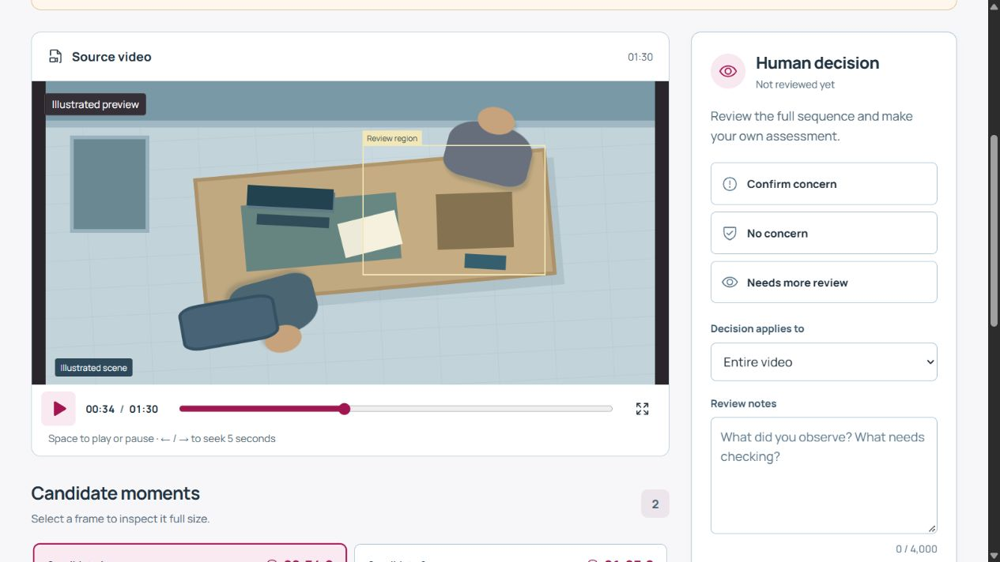

<a id="cash-review"></a>
<h1 align="center">
  
</h1>

<p align="center"><strong>Video evidence, with a clear human decision.</strong></p>
<p align="center">Local video review. Timestamped frames. Independent assessment.</p>
<p align="center">
  <a href="#install">Quickstart</a> &nbsp; | &nbsp;
  <a href="#integration-api">API</a> &nbsp; | &nbsp;
  <a href="docs/model_studies.md">Model studies</a> &nbsp; | &nbsp;
  <a href="docs/operations.md">Deployment</a> &nbsp; | &nbsp;
  <a href="https://github.com/karimbeksultan/Review./actions/workflows/ci.yml">Software checks</a>
</p>

> **Experimental detection.** The active baseline flagged all four normal clips in its original test. None of the 33 latest training variants qualified. Reliable automatic detection has not been established; use the separate human-review workflow. [Read the measured results](docs/model_studies.md).



*Built-in illustrated preview. The scene is synthetic and contains no real recording. [Russian view](docs/workspace-preview-ru.jpg).*

## Features

| Review step | What the workspace provides |
| --- | --- |
| **Inspect the recording** | Large player, precise time navigation and keyboard controls. |
| **Examine candidate moments** | Source-frame JPEGs, fractional-second timestamps, full-size viewing and zoom. |
| **Record a human decision** | Confirm concern, no concern or further review, with persistent notes and event scope. |

- English and Russian interface with locally bundled fonts.
- Local CPU inference from prepared files, private uploads and no cloud AI calls.
- Durable SQLite jobs, scoped access and isolated analysis with a five-minute deadline.
- Keyed integration API, reproducible evaluation and optional Docker packaging.

The model result and human assessment remain separate. An unqualified result displays **Human review required** while retaining its candidate frames and raw scores. This is an abstention safeguard, not an improvement in measured classifier accuracy. Cash Review does not identify people or establish legal wrongdoing.

## Current status

| Area | Evidence |
| --- | --- |
| Application software | **62 tests passed:** 52 backend and 10 frontend. [Verification](docs/verification.md) |
| Automatic detection | **Not qualified.** All 33 latest training variants failed their frozen gates. [Studies](docs/model_studies.md) |
| Data | 42 supplied videos, 40 unique content groups; fixed 24/8/8 train/selection/original-test split. [Model card](docs/model_card.md) |
| Organizers' environment | Docker execution, hardware and full service performance remain unverified. [Handoff notes](docs/operations.md#deployment-verification) |

Passing software checks is separate from detector accuracy. The original test has already been inspected; repeated use cannot establish a fresh independent result.

## Install

Use **Python 3.12** and **Node.js 22**. Keep permitted source data and model artifacts outside source control.

### 1. Prepare dependencies

From the repository root:

```powershell
python -m venv .venv
.venv/Scripts/python -m pip install -r backend/requirements.lock.txt
cd frontend
npm ci --no-audit --no-fund
npm run build
cd ..
```

### 2. Prepare private model files

The source repository contains **no trained detector weights, source videos, labels or credentials**. Follow the [model preparation and reproduction instructions](docs/model_card.md#reproduction) or provide a permitted private artifact directory. The current failed baseline supports an experimental workflow demonstration; no qualified replacement has been established.

The running API never downloads weights. Missing or corrupt artifacts produce readiness `503` and disable real analysis; the marked synthetic preview remains available.

<details>
<summary><strong>Training and historical artifact rules</strong></summary>

Training requires a fresh private artifact directory. Prepared backbone files, a frozen split and bound feature caches may exist, but model files or completed validation/evaluation reports block retraining so historical failures remain intact. Reuse the frozen split when comparing candidates; a new directory does not make an exposed test cohort fresh.

New models bind the backbone, preprocessing, sampling interval and runtime versions to their caches. Legacy aggregate reports remain readable. `evaluate.py --repeat` or `--runtime-smoke` requires a newly trained model with matching versioned feature bindings in a separate artifact directory. These tooling changes do not replace the active detector.

</details>

### 3. Start the workspace

After preparing `models/`:

```powershell
./scripts/start.ps1 -ModelDir models
```

Open **[Cash Review](http://127.0.0.1:8000)**. If no integration key is configured, the launcher creates a private one in `runtime/api-key.txt`.

<details>
<summary><strong>Linux/macOS and development mode</strong></summary>

Activate the Python environment, export `CASH_REVIEW_MODEL_DIR`, `CASH_REVIEW_DATA_DIR` and a unique `CASH_REVIEW_API_KEY`, then run:

```sh
python -m uvicorn cash_review.app:app --app-dir backend --host 127.0.0.1 --port 8000 --workers 1 --no-access-log
```

For frontend development, run `npm run dev` in `frontend/`; Vite forwards `/api` to port 8000. Production serves the built interface from the backend. Optional `VITE_API_BASE_URL` must never contain a key.

</details>

## Integration API

Send `X-API-Key` on every `/api/v1/` request. The browser receives a separate token scoped to one job.

```sh
curl -X POST http://127.0.0.1:8000/api/v1/analyze \
  -H "X-API-Key: $CASH_REVIEW_API_KEY" -F "file=@clip.mov"
# 202: {"job_id":"..."}
curl http://127.0.0.1:8000/api/v1/jobs/JOB_ID \
  -H "X-API-Key: $CASH_REVIEW_API_KEY"
```

Poll once per second. States are `processing`, `done` and `failed`. Completed raw model verdicts are `violation` or `no_violation`; both require human interpretation. Failures have an error and no verdict. Events contain type, source time, description, a context reference and one to three actual source JPEGs.

| Endpoint | Purpose |
| --- | --- |
| `GET /api/health/live` | Process liveness |
| `GET /api/health/ready` | Configuration, model integrity and registry readiness |
| `POST /api/v1/analyze` | Keyed multipart upload in field `file` |
| `GET /api/v1/jobs/{job_id}` | Keyed status and immutable model result |
| `POST /api/ui/analyze` | Browser upload and scoped token |
| `GET /api/ui/jobs/{job_id}` | Browser result and separate human review |
| `POST /api/ui/jobs/{job_id}/review` | Save human decision and notes |
| `GET /api/ui/jobs/{job_id}/media` | Authorized private media |
| `GET /api/rules` | Cached regulatory context |
| `GET /docs` | OpenAPI documentation |

<details>
<summary><strong>Human-review payload and result qualification</strong></summary>

```json
{
  "decision": "needs_review",
  "notes": "Inspect the full sequence before deciding.",
  "event_index": null
}
```

Allowed decisions are `violation`, `no_violation` and `needs_review`. Notes are limited to 4,000 Unicode codepoints. Only completed jobs can be reviewed. Reviews never overwrite model results or enter training automatically.

The browser shows a binary assessment only when that job's own metadata records both `quality_validated: true` and `validation_status: "validated"`. Otherwise its summary requires human review, regardless of the raw threshold verdict. Historical results never inherit a replacement runtime's qualification.

</details>

## Operations

The intended run is on the organizers' infrastructure. Prepare the private model directory and a new API key separately. For the optional Compose path:

```sh
# Prepare ./models and configure CASH_REVIEW_API_KEY in the host's private .env.
docker compose up --build -d
```

Set `CASH_REVIEW_ALLOWED_ORIGINS` to include the organizers' exact browser origin when using an HTTPS ingress. Compose forwards that setting. The port binds to host loopback; remote access requires the host's ingress configuration. **Docker and the target host have not been verified here.** See the [deployment handoff](docs/operations.md#deployment-verification).

| Runtime boundary | Default |
| --- | --- |
| Upload | MOV, up to 64 MiB; bounded decoded dimensions and evidence size |
| Deadline | 300 seconds, including upload parsing and queue wait |
| Execution | One Uvicorn process; bounded analysis executor with isolated native decoding |
| Retention | Media/results/reviews: 24 hours; job tokens: two hours |
| Browser access | In-memory per-job token; refreshing the page loses that token |

Expired claims cannot publish results. Keep runtime files, backups, logs and credentials private. Processing uses local files after dependencies and weights are prepared; disconnected operation and target-host performance require their own checks.

<details>
<summary><strong>Run software checks</strong></summary>

```sh
python -m pytest backend/tests -q
cd frontend
npm test
npm run build
```

Software tests use synthetic fixtures and test-only engines. They establish program behavior, not model accuracy. Detector evaluation keeps duplicate content together and reports false positives and misses. Do not tune on external submissions or previously evaluated holdouts.

</details>

## Documentation

| Topic | Reference |
| --- | --- |
| Detection limits and artifact preparation | [Model card](docs/model_card.md) |
| All measured candidate outcomes | [Model studies](docs/model_studies.md) |
| Software and interface checks | [Verification](docs/verification.md) |
| Release evidence still required | [Qualification](docs/qualification.md) |
| Deployment and recovery | [Operations](docs/operations.md) |
| Source requirements | [Requirements review](docs/requirements.md) |

Original code is [MIT licensed](LICENSE). Dependencies and pretrained weights retain their own terms. No license to private source data is granted.
